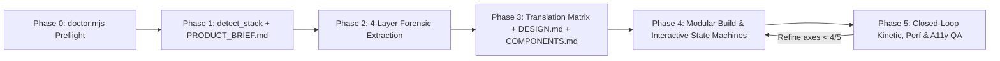

<div align="center">

# Unslop

**Forensic UI deconstruction, kinetic motion translation, and closed-loop Playwright QA — packaged as a portable Agent Skill.**

[](https://github.com/Aaryan1524/UnslopAI/actions/workflows/ci.yml)
[](./LICENSE)
[](https://agentskills.io)
[](https://nodejs.org)
[](https://playwright.dev)

*Turn generic, flat interfaces into crafted, accessible, kinetic web experiences — backed by ground-truth browser telemetry instead of guesswork.*

[Installation](#installation) · [Workflows](#three-workflows) · [Pipeline](#6-stage-pipeline-phase-0--phase-5) · [CLI Tooling](#cli-tooling) · [Capabilities & Ethics](#capabilities--ethics-contract) · [Contributing](./CONTRIBUTING.md)

</div>

---

## Why Unslop

Most frontend refactors and redesigns collapse into the same predictable failures: unprompted purple gradients, cookie-cutter three-card grids, fabricated placeholder copy, broken framework integration, missing focus rings, mobile horizontal overflow, blank or frozen `<canvas>` shaders, and non-functional overlay shells.

`unslop` replaces single-shot guesswork with an empirical browser-driven pipeline:

| Dimension | Unstructured UI Generation | With `unslop` (`v1.1.0`) |
| :--- | :--- | :--- |
| **Discovery & Stack Fit** | Invents placeholder claims and ignores existing frameworks/tokens | Runs `doctor.mjs` + `detect_stack.mjs` (Next.js, Vite, Tailwind v3/v4, shadcn/ui, Vue/Astro), inventories real repo truth, and locks `PRODUCT_BRIEF.md` |
| **Inspiration Analysis** | Guesses layout from text or a single desktop thumbnail | Extracts area-weighted colors, CSS vars, fonts, cropped component PNGs, `mobile-full.png` collapse metrics, `mediaInventory`, `interactiveStates`, viewport `entranceReveals`, and 4-frame sticky scroll filmstrips (`t0`–`t3`) |
| **Shaders & CSS Motion** | Ignores WebGL and scroll animations, replacing them with flat boxes | Hooks `WebGL/WebGL2.shaderSource` at runtime (zero source maps needed) and captures CORS-proof CSS `@keyframes`, `view-timeline`, and `cubic-bezier(...)` curves |
| **Architecture & Interactivity** | Crams complex pages into monolithic files with dead buttons | Translates bands via Adapt/Merge/Drop matrix into `DESIGN.md` + `COMPONENTS.md`, framework adapters, and accessible state-machine patterns (`Cmd+K`, drawers, calculators, multi-step forms) |
| **Closed-Loop Verification** | Assumes code works without rendering or clicking it | Runs single- or multi-route headless Chromium audits: CLS, oversized images, semantic link/heading hygiene, raw `<canvas>` pixel checks, active Motion-Off freeze, alternate-theme WCAG AA contrast, `Escape` overlay dismissal, and `320px`–`1440px` layout checks |

---

## Installation

### 1. Via Skills CLI (Recommended)

```bash
npx skills add Aaryan1524/UnslopAI
```

### 2. Via Plugin Marketplace

```text
/plugin marketplace add Aaryan1524/UnslopAI
/plugin install unslop
```

### 3. Standalone / Manual Drop-In

Copy or symlink [`skills/unslop`](./skills/unslop) into your environment's skill folder, then install Playwright inside the skill directory (or keep `playwright` in your target workspace):

- **Global skills directory:** `~/.agents/skills/unslop` or `~/.claude/skills/unslop`
- **Project-local skills directory:** `.agents/skills/unslop` or `.cursor/skills/unslop`

```bash
cd <your-skills-dir>/unslop
npm install
# Verify runtime, Playwright, browser launch, and manifest files:
node scripts/doctor.mjs
# Optional if local Google Chrome is not already installed:
npx playwright install chromium
```

> **Browser Resolution:** [`browser_helper.mjs`](./skills/unslop/scripts/browser_helper.mjs) resolves `playwright` from the skill folder or current workspace automatically and falls back to locally installed Google Chrome (`channel: 'chrome'`) if bundled Chromium binaries are absent.

---

## Three Workflows

The single unified [`unslop`](./skills/unslop/SKILL.md) skill locks the right workflow from your request:

1. **Unslop Existing UI (`unslop-existing`)**
   Detect your framework and tokens with `detect_stack.mjs`, audit the running app across routes for contrast, CLS, semantic hygiene, clipped text, broken media/canvases, and mobile overflow — then refactor component by component without breaking existing routes or logic.
   > *"Audit `http://localhost:3000` with unslop, fix the generic layout, typography contrast, and mobile overflow, and re-verify until zero errors remain."*

2. **Inspiration Deconstruction & Remix (`inspiration-remix`)**
   Lock real product truth in `PRODUCT_BRIEF.md`, forensically dissect one or more inspiration URLs/screenshots (DOM, interactive states, viewport reveals, mobile collapse, WebGL shaders, CSS scroll-timelines, filmstrips), translate bands via the Adapt/Merge/Drop matrix into `DESIGN.md` + `COMPONENTS.md`, and build an original interface.
   > *"Inspect `https://example.com` using unslop and build an original landing page for our studio in a warm editorial palette, keeping the scroll cadence and shader atmosphere."*

3. **Hybrid Refactoring (`hybrid`)**
   Extract structural and kinetic grammar from an inspiration reference and apply a safe strangler-fig migration onto an existing Next.js, Vite, Tailwind, Vue, or Astro codebase while preserving working business logic and URLs.
   > *"Deconstruct `https://example.com` with unslop and refactor our dashboard header, typography scale, and card density to adopt its rhythm."*

---

## 6-Stage Pipeline (Phase 0 – Phase 5)



| Phase | Purpose | Gate Artifacts |
| :--- | :--- | :--- |
| **0. Preflight** | Verify Node runtime, Playwright resolution, Chromium/Chrome launch, optional REA support, and skill files | `doctor.mjs` (`healthy: true`) |
| **1. Discovery & Stack** | Detect target framework/tokens, inventory repo truth, run bounded 5-question intake, disclose capabilities | `stack-report.json`, `PRODUCT_BRIEF.md` |
| **2. Forensic Extraction** | Capture DOM/CSS/GPU shaders, interactive click-probed states, entrance reveals, `mobile-full.png`, `mediaInventory`, and scroll filmstrips | `report.json`, `shaders.json`, `css-motion.json`, `components/*.png`, `mobile-full.png` |
| **3. Contracts & Remix** | Classify bands (Adapt/Merge/Drop), lock semantic tokens, art-direction brief, and component/motion specs | `DESIGN.md`, `COMPONENTS.md` |
| **4. Modular Build** | Implement framework-adapted tokens, `MotionController`, cohesive media, kinetic bands, and accessible interactive patterns | Modular `src/` codebase |
| **5. Closed-Loop QA** | Verify CLS, oversized images, semantic hygiene, raw canvases, Motion-Off freeze, alt-theme contrast, `Escape` overlays, and multi-route chrome consistency across 2+ passes | `audit.json` / `multi-route-audit.json`, `desktop.png`, `mobile.png`, `sections/*.png` |

---

## CLI Tooling

Run the standalone scripts directly from the repository root (or via `<skill-dir>/scripts/`):

```bash
# 0. Check environment readiness (Node, Playwright, Chromium/Chrome, skill files)
npm run doctor

# 1. Inspect an existing target codebase (read-only stack, routes, CSS tokens, migration advice)
npm run detect-stack -- ./my-app ./stack-report.json

# 2. Forensically inspect a public inspiration website (DOM, CSS timelines, GPU shaders, interactive states, mobile-full & filmstrips)
npm run inspect -- https://example.com ./inspect-out

# 3. Optional: Page-scoped REA accessibility, script-pattern & source-map enrichment (Node ^22.23.4 || ^24.22.1 || >=26.12.1)
npm run rea-inspect -- https://example.com ./inspect-out

# 4. Audit a local app or multi-route build (CLS, oversized images, semantics, raw <canvas>, Motion-Off, alt-theme contrast, Esc overlays)
npm run audit -- http://127.0.0.1:3000 ./audit-out
npm run audit -- http://127.0.0.1:3000 ./audit-out --routes /,/pricing,/about

# 5. Run full repository validation (manifests/links + TypeScript check + Playwright regression harness)
npm run check
```

---

## Repository Structure

```text
UnslopAI/
├── .claude-plugin/                       # Plugin & marketplace distribution manifests
├── .github/                              # Playwright CI workflow, issue forms & PR template
├── scripts/
│   └── validate-skill.mjs                # Manifest/lockfile version sync, frontmatter, reference & syntax validator
├── fixtures/                             # Deterministic offline fixtures (clean, slop, kinetic shader/scroll, interactive)
└── skills/
    └── unslop/
        ├── SKILL.md                      # 6-stage master playbook with explicit completion gates
        ├── package.json                  # Standalone runtime manifest
        ├── scripts/
        │   ├── browser_helper.mjs        # Dynamic Playwright resolver, Chrome fallback & block detector
        │   ├── doctor.mjs                # Runtime, Playwright, browser launch & manifest preflight
        │   ├── detect_stack.mjs          # Read-only framework, router, Tailwind/shadcn & CSS token detector
        │   ├── inspect_site.mjs          # 4-layer forensic dissolver (GPU shaders, CSS, states, reveals, mobile-full)
        │   ├── rea_inspect.mjs           # Optional framework-agnostic REA bundle & source-map extractor
        │   ├── audit_ui.mjs              # Performance, semantic, kinetic, raw-canvas, WCAG AA & multi-route auditor
        │   └── verify_harness.mjs        # Automated Playwright regression suite
        ├── references/
        │   ├── product-discovery-interview.md
        │   ├── product-brief-template.md
        │   ├── framework-adapters.md
        │   ├── inspiration-translation-matrix.md
        │   ├── interactive-component-patterns.md
        │   ├── capabilities-and-limitations.md
        │   ├── design-md-template.md
        │   ├── components-spec-template.md
        │   ├── motion-and-shader-grammar.md
        │   ├── visual-art-direction-and-media.md
        │   ├── curated-typography.md
        │   ├── anti-slop-checklist.md
        │   ├── taste-spectrum.md
        │   ├── tactile-hardware-grammar.md
        │   └── rea-evaluation.md
        └── assets/
            └── micro-synth.ts            # Optional zero-dependency Web Audio feedback synthesizer
```

---

## Capabilities & Ethics Contract

- **Adapt & Synthesize, Never Clone:** Transfers layout rhythm, typographic contrast, color area ratios, and kinetic physics onto 100% original brand copy, original shaders/SVGs, open-source typography, and bespoke media. Never copies logos, trademarks, copyrighted imagery, or proprietary binaries.
- **No-Fabrication Discipline:** Inventories real repository content first and enforces explicit no-fabrication redlines in `PRODUCT_BRIEF.md` (zero invented metrics, testimonials, or placeholder logos).
- **Strict Stop-on-Block Boundary:** If a target URL returns HTTP `401`/`403`/`429`/`503`, a CAPTCHA, Cloudflare Turnstile, or a login gate, automation halts immediately and falls back to user-provided screenshots. Access controls are never bypassed.
- **Reduced Motion First:** Every procedural WebGL shader, Canvas animation, CSS `view-timeline`, and scroll track honors both `@media (prefers-reduced-motion: reduce)` and a verified interactive Motion toggle.

See [`skills/unslop/references/capabilities-and-limitations.md`](./skills/unslop/references/capabilities-and-limitations.md) for the complete capability matrix.

---

## Verification & Maintenance

All changes are verified against deterministic Playwright regression suites in GitHub Actions across Node 22 and Node 24:

```bash
npm run doctor           # Environment & Chromium launch readiness
npm run validate:skill   # Synced versions (including package-lock.json), frontmatter, reference links, script syntax
npm run verify:types     # TypeScript asset verification
npm run verify           # End-to-end Playwright regression harness
```

- **Changelog:** [`CHANGELOG.md`](./CHANGELOG.md)
- **Roadmap:** [`plan.md`](./plan.md)
- **Contributing:** [`CONTRIBUTING.md`](./CONTRIBUTING.md)
- **Security Policy:** [`SECURITY.md`](./SECURITY.md)
- **License:** [MIT](./LICENSE)
