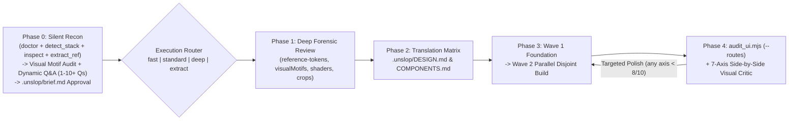

<div align="center">

# Unslop

**Visual-DNA extraction, dynamic context discovery, parallel modular engineering, and closed-loop Playwright + 7-axis visual QA — packaged as one portable Agent Skill.**

[](https://github.com/Aaryan1524/UnslopAI/actions/workflows/ci.yml)
[](./CHANGELOG.md)
[](./LICENSE)
[](https://agentskills.io)
[](https://nodejs.org)
[](https://playwright.dev)

*One minimal `/unslop` skill that inspects your codebase and inspiration site first, gathers deep context across dynamic question intervals, locks `.unslop/brief.md`, and ships fast prototypes, launch-ready sites, vibe-transfer redesigns, or single-component animation ports with automated Chromium QA and side-by-side visual lineage checks.*

[Installation](#installation) · [What's in v1.4](#architecture-highlights-v140) · [Presets](#four-execution-presets) · [Starter Prompts](#starter-prompts) · [Pipeline](#visual-dna--adaptive-pipeline-phase-0--phase-4) · [CLI Tooling](#cli-tooling) · [Capabilities & Ethics](#capabilities--ethics-contract)

</div>

---

## Why Unslop

Most AI-built frontends fail in predictable ways: rigid boilerplate prompts that ignore existing code, generic typography and cold dark-mode defaults, flattened inspiration references that miss the real site's architectural motifs, wordy prose walls instead of product-explaining animations, empty stretched card voids, broken overlays, and unverified mobile layouts.

`unslop` replaces single-shot guesswork with an inspect-first, browser-verified engineering pipeline:

| Dimension | Unstructured UI Generation | With `unslop` (`v1.4.0`) |
| :--- | :--- | :--- |
| **Phase 0 Recon & Discovery** | Jumps straight to code or asks static generic questions | Runs `doctor.mjs` + `detect_stack.mjs` + `inspect_site.mjs` + `extract_reference.mjs` **first**, conducts dynamic `1–10+` question intervals grounded in real captures, and locks `.unslop/brief.md` before coding |
| **Visual-DNA & Motif Fidelity** | Cosplays a reference from memory or only copies flat hex codes | Extracts pixel-area surface ratios, exact weights/tracking, modal radii, `visualMotifs` (dot/grid substrates, vertical guide rails, inset shader frames, pill CTAs, tinted light cards), and `copyDensity` alongside direct screenshot inspection |
| **Two-Tier Rule Precedence** | Either ships AI slop or over-corrects into one generic template | Separates **Tier 1 Universal Craft Laws** (zero voids, zero wrapped mono bars, pure navbars, WCAG AA contrast, `44px` tap targets, copy economy) from **Tier 2 Reference-Driven Grammar** (context-appropriate grotesque `500` vs. editorial serif, reference hero/button geometry) |
| **Speed vs. Depth Control** | One rigid flow for hackathons, startups, and animation ports | Routes cleanly across **`fast`**, **`standard`**, **`deep`** (Two-Wave disjoint parallel orchestration), and **`extract-component`** presets |
| **Closed-Loop QA & 7-Axis Critic** | Checks DOM existence once without inspecting rendered craft | Runs multi-route `audit_ui.mjs` (CLS, WCAG AA dual-theme contrast, Motion-Off canvas freeze, `Escape` dismissal, `studioCraft` & `copyEconomy` checks) + captures tiled desktop/mobile PNGs for a **7-Axis Side-by-Side Visual Lineage Critic (`>= 8/10`)** |

---

## Architecture Highlights (`v1.4.0`)

- **Deterministic Reference & Motif Extraction (`extract_reference.mjs`):** Measures surface polarity ratios, exact heading weights and negative tracking, geometry locks, section alignment sequences, structural `visualMotifs`, and `copyDensity` word budgets straight from the live DOM into `reference-tokens.json`.
- **Dynamic Multi-Interval Discovery (`1` to `10+` Questions):** Scales naturally from a single confirmation pass (when specs are detailed or *"Use best defaults"* is selected) to multiple focused 2–4 question intervals covering product positioning, visual motif fidelity, typography mood, copy minimalism, and product-explaining signature animations.
- **Reusable Architectural Craft Primitives (`craft-primitives.md`):** Provides production-ready CSS and Canvas building blocks for outer dot-matrix substrates, continuous vertical blueprint guide rails with corner registration squares, notched corner-bracket callouts, inset halftone/solar-glow shader frames with ticker marquees, 50/50 noise-vs-calm comparisons, luminous tinted micro-UIs, `2%` inline SVG surface grain, and non-wrapping terminal status lines.
- **Strict Lazy-Loading & Clean Target Repos:** `SKILL.md` loads only the reference playbooks required for the active phase and preset, and every target repository automatically isolates scratch recon/audit artifacts inside git-ignored `.unslop/`.

---

## Installation

### 1. Via Skills CLI (Recommended)

```bash
npx skills add Aaryan1524/UnslopAI
```

### 2. Via Plugin Marketplace

```text
/plugin marketplace add Aaryan1524/UnslopAI
/plugin install unslop
```

### 3. Standalone / Manual Drop-In

Copy or symlink [`skills/unslop`](./skills/unslop) into your agent's skills directory, then install Playwright inside the skill folder (or keep `playwright` installed in your target workspace):

- **Global skills directory:** `~/.agents/skills/unslop` or `~/.claude/skills/unslop`
- **Project-local skills directory:** `.agents/skills/unslop` or `.cursor/skills/unslop`

```bash
cd <your-skills-dir>/unslop
npm install
# Verify runtime, Playwright, Chromium launch, and all 21 core skill files:
node scripts/doctor.mjs
# Optional if local Google Chrome is not already installed:
npx playwright install chromium
```

> **Automatic Browser Resolution:** [`browser_helper.mjs`](./skills/unslop/scripts/browser_helper.mjs) resolves `playwright` from the skill folder or active workspace automatically and falls back to locally installed Google Chrome (`channel: 'chrome'`) if bundled Chromium binaries are absent.

---

## Four Execution Presets

The unified [`unslop`](./skills/unslop/SKILL.md) skill adapts scope, discovery depth, and verification rigor during Phase 0:

| Preset | Best For | What Runs |
| :--- | :--- | :--- |
| **`fast`** | Hackathons, rapid prototypes, quick visual spikes | Fast recon + `1` quick confirmation interval (or *"Use best defaults"*) → compact `.unslop/brief.md` → single modular build pass → 1 `audit_ui.mjs` pass |
| **`standard`** | Production product pages and existing-app redesigns | Full recon (`inspect_site.mjs` + `extract_reference.mjs`) + dynamic Q&A intervals → `.unslop/brief.md`, `DESIGN.md`, `COMPONENTS.md` → modular build → 1–2 `audit_ui.mjs` passes + tiled visual check |
| **`deep`** | Launch-ready startup websites & flagship interactive apps | Full 4-layer extraction (+ optional REA) + visual screenshot motif audit + dynamic multi-interval discovery → full contracts → **Two-Wave Disjoint Parallel Orchestration** → multi-route `audit_ui.mjs --routes` + **Pass-3 7-Axis Side-by-Side Visual Critic (`>= 8/10`)** |
| **`extract-component`** | Engineers dissecting or porting **one specific animation, shader, or interactive widget** | Targeted `inspect_site.mjs` (`css-motion.json`, `shaders.json`, `interactiveStates`) + focused technical Q&A → isolated reduced-motion-safe drop-in component adapted to your stack → targeted QA |

See [`skills/unslop/references/execution-modes-and-prompts.md`](./skills/unslop/references/execution-modes-and-prompts.md) for the complete preset matrix.

---

## Starter Prompts

Get the strongest output by stating **what you are building (or your existing repo)**, **optional inspiration URL(s) + what specific visual/motion traits you want**, and **your desired depth (`fast` vs. `deep`)**:

- **Fast Prototype (`fast`):**
  > *"Use unslop in fast mode. Build a working landing page and interactive demo for `[Product Name]` inspired by `[https://reference.example]`. Keep the layout pacing and typography feel, use clean defaults where unspecified, and verify it renders cleanly."*
- **Launch-Ready Flagship (`deep` + Parallel Build):**
  > *"Use unslop in deep / launch-ready mode to build a complete website for `[Product Name]`. Inspiration: `[https://reference.example]` — carry over the geometric framing lines, dot-matrix atmosphere, minimal copy density, and product-explaining animations. Ask as many discovery questions as needed in intervals, lock `.unslop/brief.md`, then build with parallel orchestration and full multi-route QA."*
- **Redesign Existing Site / Vibe Transfer:**
  > *"Use unslop to redesign my existing app (`[http://localhost:3000]`) using `[https://reference.example]` as visual inspiration. Keep all existing product copy, routes, and working logic intact — transfer only the layout geometry, visual motifs, typography hierarchy, palette polarity, and motion."*
- **Dissect & Port One Animation / Component (`extract-component`):**
  > *"Use unslop in extract-component mode. Inspect `[https://reference.example]`, reverse-engineer `[the halftone shader hero / sticky scroll walkthrough / frosted command palette]`, and implement an original reduced-motion-safe version inside my existing repo without touching unrelated pages."*

---

## Visual-DNA & Adaptive Pipeline (Phase 0 – Phase 4)



All scratch recon captures, design contracts, and Playwright audit artifacts live cleanly inside **`.unslop/`** (`brief.md`, `stack-report.json`, `inspect/`, `DESIGN.md`, `COMPONENTS.md`, `audit/`) and are git-ignored so generated projects stay spotless.

---

## CLI Tooling

Run any script directly from the repository root (or via `<skill-dir>/scripts/`):

```bash
# 0. Verify environment readiness (Node, Playwright, Chromium/Chrome, 21 core skill files)
npm run doctor

# 1. Inspect an existing target codebase (read-only framework, router, styling & CSS token scan)
npm run detect-stack -- ./my-app ./.unslop/stack-report.json

# 2. Forensically inspect an inspiration URL + extract measured DOM/CSS, visualMotifs & copyDensity tokens
npm run inspect -- https://example.com ./.unslop/inspect
npm run extract-ref -- https://example.com ./.unslop/inspect/reference-tokens.json

# 3. Optional: Page-scoped REA accessibility, script-pattern & source-map enrichment (Node ^22.23.4 || ^24.22.1 || >=26.12.1)
npm run rea-inspect -- https://example.com ./.unslop/inspect

# 4. Audit a local app or multi-route build + capture 7-axis Pass-3 visual critic tiles
npm run audit -- http://127.0.0.1:3000 ./.unslop/audit/pass-1
npm run audit -- http://127.0.0.1:3000 ./.unslop/audit/pass-1 --routes /,/pricing,/about

# 5. Run full repository validation (manifests/links + TypeScript check + 11-suite Playwright harness)
npm run check
```

---

## Repository Structure

```text
UnslopAI/
├── .claude-plugin/                       # Plugin & marketplace distribution manifests
├── .github/                              # Playwright CI workflow, issue forms & PR template
├── scripts/
│   └── validate-skill.mjs                # Manifest/lockfile version sync, frontmatter, reference & syntax validator
├── fixtures/                             # Deterministic offline fixtures (clean, slop, kinetic shader/scroll, interactive)
└── skills/
    └── unslop/
        ├── SKILL.md                      # Unified adaptive playbook with Phase 0 discovery & completion gates
        ├── package.json                  # Standalone runtime manifest
        ├── scripts/
        │   ├── browser_helper.mjs        # Dynamic Playwright resolver, Chrome fallback & block detector
        │   ├── doctor.mjs                # Runtime, Playwright, browser launch & 21-file manifest preflight
        │   ├── detect_stack.mjs          # Read-only framework, router, Tailwind/shadcn & CSS token detector
        │   ├── extract_reference.mjs     # Surface ratios, typography, radii, alignment, visualMotifs & copyDensity
        │   ├── inspect_site.mjs          # 4-layer forensic dissolver, shader hooks, scroll filmstrips & reconDigest
        │   ├── rea_inspect.mjs           # Optional framework-agnostic REA bundle & source-map extractor
        │   ├── audit_ui.mjs              # Perf, semantic, kinetic, studioCraft, copyEconomy & 7-axis tiled critic
        │   └── verify_harness.mjs        # 11-suite automated Playwright regression harness
        ├── references/                   # 19 lazy-loaded design, discovery, orchestration & QA playbooks
        │   ├── product-discovery-interview.md
        │   ├── product-brief-template.md
        │   ├── execution-modes-and-prompts.md
        │   ├── parallel-orchestration.md
        │   ├── type-pairings.md
        │   ├── craft-primitives.md
        │   ├── framework-adapters.md
        │   ├── inspiration-translation-matrix.md
        │   ├── interactive-component-patterns.md
        │   ├── capabilities-and-limitations.md
        │   ├── design-md-template.md
        │   ├── components-spec-template.md
        │   ├── motion-and-shader-grammar.md
        │   ├── visual-art-direction-and-media.md
        │   ├── curated-typography.md
        │   ├── anti-slop-checklist.md
        │   ├── taste-spectrum.md
        │   ├── tactile-hardware-grammar.md
        │   └── rea-evaluation.md
        └── assets/
            └── micro-synth.ts            # Optional zero-dependency Web Audio feedback synthesizer
```

---

## Capabilities & Ethics Contract

- **Adapt & Synthesize, Never Clone:** Transfers spatial framing, typographic tension, surface polarity, and kinetic physics onto 100% original brand copy, original shaders/SVGs, open-source typography, and bespoke media. Never copies logos, trademarks, copyrighted imagery, or proprietary source code.
- **No-Fabrication Discipline:** Inventories real repository content first and enforces explicit no-fabrication redlines in `.unslop/brief.md` (zero invented metrics, testimonials, or placeholder logos).
- **Strict Stop-on-Block Boundary:** If a target URL returns HTTP `401`/`403`/`429`/`503`, a CAPTCHA, Cloudflare Turnstile, or a login gate, automation halts immediately and falls back to user-provided screenshots. Access controls are never bypassed.
- **Reduced Motion First:** Every procedural WebGL shader, Canvas animation, ticker marquee, CSS `view-timeline`, and scroll track honors both `@media (prefers-reduced-motion: reduce)` and a verified interactive Motion toggle.

See [`skills/unslop/references/capabilities-and-limitations.md`](./skills/unslop/references/capabilities-and-limitations.md) for the complete capability matrix.

---

## Verification & Maintenance

All changes are verified against deterministic Playwright regression suites in GitHub Actions across Node 22 and Node 24:

```bash
npm run doctor           # Environment, Chromium launch & 21 core skill files check
npm run validate:skill   # Synced versions (including package-lock.json), frontmatter, 19 reference links & script syntax
npm run verify:types     # TypeScript asset verification
npm run verify           # 11-suite Playwright regression harness
```

- **Changelog:** [`CHANGELOG.md`](./CHANGELOG.md)
- **Roadmap:** [`plan.md`](./plan.md)
- **Contributing:** [`CONTRIBUTING.md`](./CONTRIBUTING.md)
- **Security Policy:** [`SECURITY.md`](./SECURITY.md)
- **License:** [MIT](./LICENSE)
