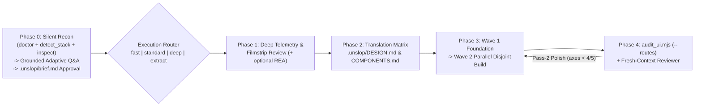

<div align="center">

# Unslop

**Inspect-first adaptive UI discovery, forensic motion & shader deconstruction, parallel modular crafting, and closed-loop Playwright QA — packaged as one portable Agent Skill.**

[](https://github.com/Aaryan1524/UnslopAI/actions/workflows/ci.yml)
[](./LICENSE)
[](https://agentskills.io)
[](https://nodejs.org)
[](https://playwright.dev)

*One minimal `/unslop` skill that inspects your workspace and inspiration site first, interviews you with reference-grounded questions, locks `.unslop/brief.md`, and builds fast prototypes, launch-ready sites, vibe-transfer redesigns, or single-component animation ports with automated Chromium QA.*

[Installation](#installation) · [Execution Presets](#four-execution-presets) · [Starter Prompts](#starter-prompts) · [Pipeline](#adaptive-pipeline-phase-0--phase-4) · [CLI Tooling](#cli-tooling) · [Capabilities & Ethics](#capabilities--ethics-contract) · [Contributing](./CONTRIBUTING.md)

</div>

---

## Why Unslop

Most frontend builds and redesigns fail in predictable ways: generic boilerplate interviews that ignore what already exists, unprompted template styling, fabricated placeholder copy, broken framework integration, missing focus rings, mobile horizontal overflow, blank `<canvas>` shaders, and non-functional overlays.

`unslop` replaces single-shot guesswork with an inspect-first, adaptive browser-driven pipeline:

| Dimension | Unstructured UI Generation | With `unslop` (`v1.4.0`) |
| :--- | :--- | :--- |
| **Phase 0 Discovery** | Jumps straight to code or asks rigid generic questions | Runs `doctor.mjs` + `detect_stack.mjs` + `inspect_site.mjs` + `extract_reference.mjs` (`reference-tokens.json` with `visualMotifs` + `copyDensity`) **first**, conducts dynamic `1–10+` question intervals, and locks `.unslop/brief.md` before coding |
| **Visual DNA & Copy Economy** | Over-corrects into generic templates or walls of text | Enforces **Two-Tier Precedence** (Universal Craft Laws + Reference-Driven Visual Grammar), context-driven typography (technical grotesque `500` vs. editorial serif), architectural primitives (`craft-primitives.md`), and concise animation-led copy |
| **Speed vs. Depth Control** | One rigid workflow for hackathons, businesses, and quick animations | Adapts cleanly across **`fast`**, **`standard`**, **`deep`** (launch-ready + Two-Wave parallel build), and **`extract-component`** presets |
| **Inspiration Analysis** | Cosplays aesthetic from memory or a single desktop thumbnail | Measures exact pixel-area polarity ratios, modal radii, section alignment %, `reconDigest`, `mobile-full.png`, `interactiveStates`, GPU `shaderSource` hooks, CORS-proof CSS timelines, and scroll filmstrips |
| **Closed-Loop QA & Pass-3 Critic** | Audits DOM math once (missing dead voids & wrapped chips) | Runs `audit_ui.mjs` (CLS, WCAG AA contrast, `studioCraft` checks for radius drift, >2 centered pyramids, stretched card voids, wrapped mono bars & header clutter) + captures `critic-desktop/mobile-*.png` tiles for Pass-3 Visual Critic (`>= 8/10`) |

---

## Installation

### 1. Via Skills CLI (Recommended)

```bash
npx skills add Aaryan1524/UnslopAI
```

### 2. Via Plugin Marketplace

```text
/plugin marketplace add Aaryan1524/UnslopAI
/plugin install unslop
```

### 3. Standalone / Manual Drop-In

Copy or symlink [`skills/unslop`](./skills/unslop) into your environment's skill folder, then install Playwright inside the skill directory (or keep `playwright` in your target workspace):

- **Global skills directory:** `~/.agents/skills/unslop` or `~/.claude/skills/unslop`
- **Project-local skills directory:** `.agents/skills/unslop` or `.cursor/skills/unslop`

```bash
cd <your-skills-dir>/unslop
npm install
# Verify runtime, Playwright, browser launch, and manifest files:
node scripts/doctor.mjs
# Optional if local Google Chrome is not already installed:
npx playwright install chromium
```

> **Browser Resolution:** [`browser_helper.mjs`](./skills/unslop/scripts/browser_helper.mjs) resolves `playwright` from the skill folder or current workspace automatically and falls back to locally installed Google Chrome (`channel: 'chrome'`) if bundled Chromium binaries are absent.

---

## Four Execution Presets

The single unified [`unslop`](./skills/unslop/SKILL.md) skill adapts its depth and workflow during Phase 0:

| Preset | Best For | What Runs |
| :--- | :--- | :--- |
| **`fast`** | Hackathons, rapid prototypes, quick visual spikes | Quick recon + 1–2 short Q&A rounds (or *"Use best defaults"*) → compact `.unslop/brief.md` → single modular build pass (no heavy custom shaders/artgen) → 1 `audit_ui.mjs` pass |
| **`standard`** | Day-to-day product pages and existing-app redesigns | Full recon + 2–3 grounded Q&A rounds → `.unslop/brief.md`, `DESIGN.md`, `COMPONENTS.md` → modular build → 1–2 `audit_ui.mjs` passes |
| **`deep`** | Launch-ready business websites & flagship interactive apps | Full 4-layer extraction (+ optional REA) + grounded Q&A → full contracts → **Two-Wave Disjoint Parallel Orchestration** + cohesive media → mandatory 2-pass `audit_ui.mjs --routes` + **Independent Fresh-Context Reviewer** |
| **`extract-component`** | Technical devs dissecting or porting **one specific animation, shader, or interactive widget** | Targeted `inspect_site.mjs` (`css-motion.json`, `shaders.json`, `interactiveStates`) + focused technical Q&A → isolated drop-in component matching your detected stack → targeted QA |

See [`skills/unslop/references/execution-modes-and-prompts.md`](./skills/unslop/references/execution-modes-and-prompts.md) for the complete preset matrix.

---

## Starter Prompts

You get the strongest first pass by stating **what you are building (or your existing repo)**, **optional inspiration URL(s) + what specifically you like**, and **your desired depth (`fast` vs. `deep`)**:

- **Fast Prototype (`fast`):**
  > *"Use unslop in fast mode. Build a working landing page and interactive demo for `[Product Name]` inspired by `[https://reference.example]`. Keep the pacing and typography feel, use clean defaults where unspecified, and verify it renders cleanly."*
- **Launch-Ready Website (`deep` + Parallel Build):**
  > *"Use unslop in deep / launch-ready mode to build a complete website for `[Product Name]`. Inspiration: `[https://reference.example]` — I specifically like `[the hero cadence, frosted search nav, and 2-column feature grid]`. Run the discovery interview first, lock `.unslop/brief.md`, then build with parallel orchestration and full multi-route QA."*
- **Redesign Existing Site / Vibe Transfer:**
  > *"Use unslop to redesign my existing app (`[http://localhost:3000]`) using `[https://reference.example]` as visual inspiration. Keep all my existing product copy, routes, and working logic intact — only transfer the layout spacing, typography hierarchy, palette feel, and motion."*
- **Dissect & Port One Animation / Component (`extract-component`):**
  > *"Use unslop in extract-component mode. Inspect `[https://reference.example]`, reverse-engineer `[the sticky scroll reveal / WebGL background / frosted search overlay]`, and implement an original reduced-motion-safe version inside my existing repo without touching unrelated pages."*

---

## Adaptive Pipeline (Phase 0 – Phase 4)



All scratch recon captures, contracts, and audit outputs live neatly inside **`.unslop/`** (`brief.md`, `stack-report.json`, `inspect/`, `DESIGN.md`, `COMPONENTS.md`, `audit/`) so your project root stays clean.

---

## CLI Tooling

Run the standalone scripts directly from the repository root (or via `<skill-dir>/scripts/`):

```bash
# 0. Check environment readiness (Node, Playwright, Chromium/Chrome, 18 core skill files)
npm run doctor

# 1. Inspect an existing target codebase (read-only stack, routes, CSS tokens, migration advice)
npm run detect-stack -- ./my-app ./.unslop/stack-report.json

# 2. Forensically inspect a public inspiration website + extract measured DOM/CSS reference tokens
npm run inspect -- https://example.com ./.unslop/inspect
npm run extract-ref -- https://example.com ./.unslop/inspect/reference-tokens.json

# 3. Optional: Page-scoped REA accessibility, script-pattern & source-map enrichment (Node ^22.23.4 || ^24.22.1 || >=26.12.1)
npm run rea-inspect -- https://example.com ./.unslop/inspect

# 4. Audit a local app or multi-route build + generate Pass-3 visual critic tiles
npm run audit -- http://127.0.0.1:3000 ./.unslop/audit/pass-1
npm run audit -- http://127.0.0.1:3000 ./.unslop/audit/pass-1 --routes /,/pricing,/about

# 5. Run full repository validation (manifests/links + TypeScript check + Playwright regression harness)
npm run check
```

---

## Repository Structure

```text
UnslopAI/
├── .claude-plugin/                       # Plugin & marketplace distribution manifests
├── .github/                              # Playwright CI workflow, issue forms & PR template
├── scripts/
│   └── validate-skill.mjs                # Manifest/lockfile version sync, frontmatter, reference & syntax validator
├── fixtures/                             # Deterministic offline fixtures (clean, slop, kinetic shader/scroll, interactive)
└── skills/
    └── unslop/
        ├── SKILL.md                      # Unified adaptive playbook with Phase 0 discovery & completion gates
        ├── package.json                  # Standalone runtime manifest
        ├── scripts/
        │   ├── browser_helper.mjs        # Dynamic Playwright resolver, Chrome fallback & block detector
        │   ├── doctor.mjs                # Runtime, Playwright, browser launch & manifest preflight
        │   ├── detect_stack.mjs          # Read-only framework, router, Tailwind/shadcn & CSS token detector
        │   ├── extract_reference.mjs     # Measured surface ratios, weights, tracking, radii & alignment tokens
        │   ├── inspect_site.mjs          # 4-layer forensic dissolver + interview-ready reconDigest
        │   ├── rea_inspect.mjs           # Optional framework-agnostic REA bundle & source-map extractor
        │   ├── audit_ui.mjs              # Perf, semantic, kinetic, studio-craft & tiled Pass-3 critic auditor
        │   └── verify_harness.mjs        # Automated Playwright regression harness
        ├── references/
        │   ├── product-discovery-interview.md
        │   ├── product-brief-template.md
        │   ├── execution-modes-and-prompts.md
        │   ├── parallel-orchestration.md
        │   ├── type-pairings.md
        │   ├── craft-primitives.md
        │   ├── framework-adapters.md
        │   ├── inspiration-translation-matrix.md
        │   ├── interactive-component-patterns.md
        │   ├── capabilities-and-limitations.md
        │   ├── design-md-template.md
        │   ├── components-spec-template.md
        │   ├── motion-and-shader-grammar.md
        │   ├── visual-art-direction-and-media.md
        │   ├── curated-typography.md
        │   ├── anti-slop-checklist.md
        │   ├── taste-spectrum.md
        │   ├── tactile-hardware-grammar.md
        │   └── rea-evaluation.md
        └── assets/
            └── micro-synth.ts            # Optional zero-dependency Web Audio feedback synthesizer
```

---

## Capabilities & Ethics Contract

- **Adapt & Synthesize, Never Clone:** Transfers layout rhythm, typographic contrast, color area ratios, and kinetic physics onto 100% original brand copy, original shaders/SVGs, open-source typography, and bespoke media. Never copies logos, trademarks, copyrighted imagery, or proprietary binaries.
- **No-Fabrication Discipline:** Inventories real repository content first and enforces explicit no-fabrication redlines in `.unslop/brief.md` (zero invented metrics, testimonials, or placeholder logos).
- **Strict Stop-on-Block Boundary:** If a target URL returns HTTP `401`/`403`/`429`/`503`, a CAPTCHA, Cloudflare Turnstile, or a login gate, automation halts immediately and falls back to user-provided screenshots. Access controls are never bypassed.
- **Reduced Motion First:** Every procedural WebGL shader, Canvas animation, CSS `view-timeline`, and scroll track honors both `@media (prefers-reduced-motion: reduce)` and a verified interactive Motion toggle.

See [`skills/unslop/references/capabilities-and-limitations.md`](./skills/unslop/references/capabilities-and-limitations.md) for the complete capability matrix.

---

## Verification & Maintenance

All changes are verified against deterministic Playwright regression suites in GitHub Actions across Node 22 and Node 24:

```bash
npm run doctor           # Environment & Chromium launch readiness
npm run validate:skill   # Synced versions (including package-lock.json), frontmatter, reference links, script syntax
npm run verify:types     # TypeScript asset verification
npm run verify           # 10-suite Playwright regression harness
```

- **Changelog:** [`CHANGELOG.md`](./CHANGELOG.md)
- **Roadmap:** [`plan.md`](./plan.md)
- **Contributing:** [`CONTRIBUTING.md`](./CONTRIBUTING.md)
- **Security Policy:** [`SECURITY.md`](./SECURITY.md)
- **License:** [MIT](./LICENSE)
