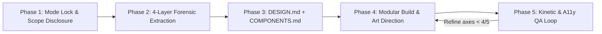

<div align="center">

# Unslop

**Forensic UI deconstruction, kinetic motion translation, and closed-loop Playwright QA — packaged as a portable Agent Skill.**

[](https://github.com/Aaryan1524/UnslopAI/actions/workflows/ci.yml)
[](./LICENSE)
[](https://agentskills.io)
[](https://nodejs.org)
[](https://playwright.dev)

*Turn generic, flat interfaces into crafted, accessible, kinetic web experiences — backed by ground-truth browser telemetry instead of guesswork.*

[Installation](#installation) · [Workflows](#three-workflows) · [Architecture](#5-phase-pipeline) · [CLI Tools](#cli-tooling) · [Ethics & Scope](#capabilities--ethics-contract) · [Contributing](./CONTRIBUTING.md)

</div>

---

## Why Unslop

Most frontend refactors and redesigns collapse into the same predictable failures: unprompted purple gradients, cookie-cutter three-card grids, missing focus rings, mobile horizontal overflow, blank or frozen `<canvas>` shaders, and flat static placeholders wherever real choreography belongs.

`unslop` replaces single-shot guesswork with an empirical browser-driven pipeline:

| Dimension | Unstructured UI Generation | With `unslop` (`v1.0.0`) |
| :--- | :--- | :--- |
| **Inspiration Analysis** | Guesses layout from text or a blurry full-page screenshot | Extracts area-weighted colors, `:root` CSS vars, fonts, cropped component PNGs, and 4-frame sticky scroll filmstrips (`t0`–`t3`) |
| **Shaders & CSS Motion** | Ignores WebGL and scroll animations, replacing them with flat boxes | Hooks `WebGL/WebGL2.shaderSource` at runtime (zero source maps needed) and captures CORS-proof CSS `@keyframes`, `view-timeline`, and `cubic-bezier(...)` curves |
| **Code Structure** | Crams complex pages into one fragile monolithic HTML file | Synthesizes paired `DESIGN.md` + `COMPONENTS.md` contracts and builds modular components wired to a global `MotionController` |
| **Visual Cohesion** | Empty CSS rectangles or mismatched stock icons | Locks one unified visual art-direction brief (lighting, palette, grain, aspect ratios) with procedural Canvas/WebGL fallbacks |
| **Verification** | Assumes code works without rendering it | Runs headless Chromium audits across `320px`–`1440px`: raw uncontaminated `<canvas>` pixel checks, scroll-mutation checks, WCAG AA contrast, keyboard focus, and mobile collision checks |

---

## Installation

### 1. Via Skills CLI (Recommended)

```bash
npx skills add Aaryan1524/UnslopAI
```

### 2. Via Plugin Marketplace

```text
/plugin marketplace add Aaryan1524/UnslopAI
/plugin install unslop
```

### 3. Standalone / Manual Drop-In

Copy or symlink [`skills/unslop`](./skills/unslop) into your environment's skill folder, then install Playwright inside the skill directory (or keep `playwright` in your target workspace):

- **Global skills directory:** `~/.agents/skills/unslop` or `~/.claude/skills/unslop`
- **Project-local skills directory:** `.agents/skills/unslop` or `.cursor/skills/unslop`

```bash
cd <your-skills-dir>/unslop
npm install
# Optional if local Google Chrome is not already installed:
npx playwright install chromium
```

> **Browser Resolution:** [`browser_helper.mjs`](./skills/unslop/scripts/browser_helper.mjs) resolves `playwright` from the skill folder or current workspace automatically and falls back to locally installed Google Chrome (`channel: 'chrome'`) if bundled Chromium binaries are absent.

---

## Three Workflows

The single unified [`unslop`](./skills/unslop/SKILL.md) skill locks the right workflow from your request:

1. **Unslop Existing UI (`unslop-existing`)**
   Audit a running local app for generic defaults, contrast failures, clipped text, broken media/canvases, and mobile overflow — then refactor component by component and re-verify until clean.
   > *"Audit `http://localhost:3000` with unslop, fix the generic layout, typography contrast, and mobile overflow, and re-verify until zero errors remain."*

2. **Inspiration Deconstruction & Remix (`inspiration-remix`)**
   Forensically dissect an inspiration URL or screenshots (layout cadence, typography scale, WebGL shaders, CSS scroll-timelines, sticky scroll filmstrips) into `DESIGN.md` + `COMPONENTS.md`, and build an original interface tailored to your product and palette.
   > *"Inspect `https://example.com` using unslop and build an original landing page for our studio in a warm editorial palette, keeping the scroll cadence and shader atmosphere."*

3. **Hybrid Refactoring (`hybrid`)**
   Extract structural and kinetic grammar from an inspiration reference and migrate an existing codebase onto that design system without losing existing domain features.
   > *"Deconstruct `https://example.com` with unslop and refactor our dashboard header, typography scale, and card density to adopt its rhythm."*

---

## 5-Phase Pipeline



| Phase | Purpose | Primary Artifacts |
| :--- | :--- | :--- |
| **1. Intake & Disclosure** | Lock mode, stack, media strategy, taste rule, and honest capabilities boundary | Scope confirmation |
| **2. Forensic Extraction** | Run Playwright DOM/CSS/GPU/filmstrip extraction (+ optional REA bundle enrichment) | `report.json`, `shaders.json`, `css-motion.json`, `components/*.png`, `rea-report.json` |
| **3. Dual Contracts** | Translate telemetry into semantic tokens, unified art-direction brief, and band-by-band motion contracts | `DESIGN.md`, `COMPONENTS.md` |
| **4. Modular Build** | Build isolated tokens, global `MotionController`, cohesive media, shell, and components in order | Modular `src/` codebase |
| **5. Closed-Loop QA** | Audit raw canvases, scroll mutations, WCAG AA contrast, focus rings, tap targets, and mobile collisions across 2+ passes | `audit.json`, `desktop.png`, `mobile.png`, `sections/*.png` |

---

## CLI Tooling

Run the standalone scripts directly from the repository root (or via `<skill-dir>/scripts/`):

```bash
# 1. Forensically inspect a public inspiration website (DOM, CSS timelines, GPU shaders, component crops & filmstrips)
npm run inspect -- https://example.com ./inspect-out

# 2. Optional: Page-scoped REA accessibility, script-pattern & source-map enrichment (Node ^22.23.4 || ^24.22.1 || >=26.12.1)
npm run rea-inspect -- https://example.com ./inspect-out

# 3. Audit a local app or build (WCAG AA, overflow across 320-1440px, raw <canvas> check, kinetic scroll checks, mobile collisions)
npm run audit -- http://127.0.0.1:3000 ./audit-out

# 4. Run full repository validation (manifest/link checks + TypeScript check + 5 Playwright fixture suites)
npm run check
```

---

## Repository Structure

```text
UnslopAI/
├── .claude-plugin/                       # Plugin & marketplace distribution manifests
├── .github/                              # Playwright CI workflow, issue forms & PR template
├── scripts/
│   └── validate-skill.mjs                # Manifest, frontmatter, link & script syntax validator
├── fixtures/                             # Deterministic offline fixtures (clean, slop, kinetic shader/scroll)
└── skills/
    └── unslop/
        ├── SKILL.md                      # Lean 5-phase master playbook (Agent Skills spec)
        ├── package.json                  # Standalone runtime manifest
        ├── scripts/
        │   ├── browser_helper.mjs        # Dynamic Playwright resolver, Chrome fallback & block detector
        │   ├── inspect_site.mjs          # 4-layer forensic dissolver (GPU shader hook, CSS capture, filmstrips)
        │   ├── rea_inspect.mjs           # Optional framework-agnostic REA bundle & source-map extractor
        │   ├── audit_ui.mjs              # Kinetic, raw-canvas, WCAG AA, focus & mobile collision auditor
        │   └── verify_harness.mjs        # 5-suite automated regression harness
        ├── references/
        │   ├── capabilities-and-limitations.md
        │   ├── design-md-template.md
        │   ├── components-spec-template.md
        │   ├── motion-and-shader-grammar.md
        │   ├── visual-art-direction-and-media.md
        │   ├── curated-typography.md
        │   ├── anti-slop-checklist.md
        │   ├── taste-spectrum.md
        │   ├── tactile-hardware-grammar.md
        │   └── rea-evaluation.md
        └── assets/
            └── micro-synth.ts            # Optional zero-dependency Web Audio feedback synthesizer
```

---

## Capabilities & Ethics Contract

- **Adapt & Synthesize, Never Clone:** Transfers layout rhythm, typographic contrast, color area ratios, and kinetic physics onto 100% original brand copy, original shaders/SVGs, open-source typography, and bespoke media. Never copies logos, trademarks, copyrighted imagery, or proprietary binaries.
- **Strict Stop-on-Block Boundary:** If a target URL returns HTTP `401`/`403`/`429`/`503`, a CAPTCHA, Cloudflare Turnstile, or a login gate, automation halts immediately and falls back to user-provided screenshots. Access controls are never bypassed.
- **Reduced Motion First:** Every procedural WebGL shader, Canvas animation, CSS `view-timeline`, and scroll track honors both `@media (prefers-reduced-motion: reduce)` and an interactive motion toggle.

See [`skills/unslop/references/capabilities-and-limitations.md`](./skills/unslop/references/capabilities-and-limitations.md) for the complete capability matrix.

---

## Verification & Maintenance

All changes are verified against 5 deterministic Playwright regression suites in GitHub Actions across Node 22 and Node 24:

```bash
npm run validate:skill   # Manifests, frontmatter, relative links, script syntax
npm run verify:types     # TypeScript asset verification
npm run verify           # Clean, slop, kinetic shader/timeline, dedup, inert & blank-canvas-under-text suites
```

- **Changelog:** [`CHANGELOG.md`](./CHANGELOG.md)
- **Roadmap:** [`plan.md`](./plan.md)
- **Contributing:** [`CONTRIBUTING.md`](./CONTRIBUTING.md)
- **Security Policy:** [`SECURITY.md`](./SECURITY.md)
- **License:** [MIT](./LICENSE)
