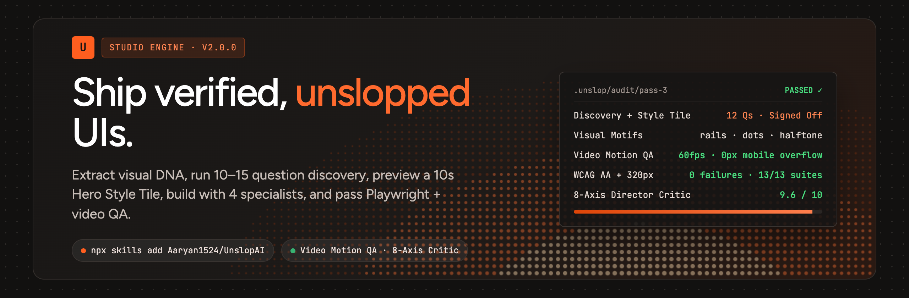
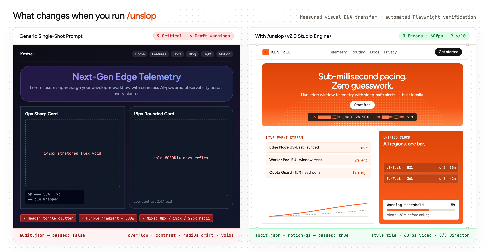

<div align="center">



<br />

[](https://github.com/Aaryan1524/UnslopAI/actions/workflows/ci.yml)
[](./CHANGELOG.md)
[](./LICENSE)
[](https://agentskills.io)
[](https://nodejs.org)
[](https://playwright.dev)

**One portable `/unslop` Studio Engine that extracts visual DNA, runs 10–15 question deep discovery, previews a 10-second Hero Style Tile, builds with a 4-specialist parallel guild, and verifies every frame in Chromium.**

[Quick Start](#quick-start) · [Before & After](#before-vs-after) · [How It Works](#how-it-works) · [Demo Prompts](#demo-prompts) · [Try Locally](#try-locally)

</div>

---

## Quick Start

Install in any Agent Skills-compatible coding agent:

```bash
npx skills add Aaryan1524/UnslopAI
```

Or via plugin marketplace:

```text
/plugin marketplace add Aaryan1524/UnslopAI
/plugin install unslop
```

Then invoke `/unslop` with your product + optional inspiration URL:

```text
/unslop Build a launch-ready site for [MyProduct] inspired by [https://reference.example]
```

---

## Before vs. After



Instead of guessing from training weights, `/unslop` parses your full end-to-end requirements across 10–15 grounded questions, validates visual direction via a 10-second browser-rendered Hero Style Tile, builds real interactive product proofs, and blocks shipping until Playwright, scroll-video Motion QA, and the 8-axis Design Director critic pass.

---

## How It Works


| Preset | Best For | Pipeline |
| :--- | :--- | :--- |
| **`fast`** | Hackathons & rapid prototypes | Quick recon → 1–2 confirmations → single modular build → 1 Playwright audit |
| **`standard`** | Production sites & app redesigns | Full recon → **10–15 question discovery** → **10s Hero Style Tile** → modular build → `audit_ui` + optional `motion-qa` |
| **`deep`** | Flagship launches & kinetic web apps | Full 4-layer extraction → **10–15 question discovery** → **10s Hero Style Tile** → **4-Specialist Parallel Guild** → multi-route `audit_ui` + **scroll-video Motion QA** + **8-Axis Director Critic (`>= 8/10`)** |
| **`extract-component`** | Porting 1 shader, motion, or widget | Targeted `css-motion` / `shaders` recon → 3–5 technical Qs → reduced-motion drop-in → focused QA |

---

## Demo Prompts

Copy, replace the brackets, and run:

- **Launch-ready studio site (`deep`):**
  > `/unslop Build a complete launch-ready website for [Product] inspired by [https://reference.example]. Run the full 10–15 question discovery interview across intervals, show me the 10-second Hero Style Tile checkpoint first, then build with the 4-specialist parallel guild and full Playwright + video motion QA.`
- **Fast working MVP (`fast`):**
  > `/unslop in fast mode: build a landing page and interactive demo for [Product] inspired by [https://reference.example]. Use best defaults and verify zero layout breaks.`
- **Redesign an existing app:**
  > `/unslop Redesign my app at [http://localhost:3000] using [https://reference.example] for layout, typography, and motion. Keep all existing copy, routes, and logic intact.`
- **Port one animation or component (`extract-component`):**
  > `/unslop in extract-component mode: inspect [https://reference.example] and build an original reduced-motion-safe version of [the hero shader / sticky walkthrough / command bar] in my repo.`

---

## Try Locally

Clone the repo and run the style-tile generator, reference extractor, video motion QA, or full 13-suite Playwright verification harness:

```bash
git clone https://github.com/Aaryan1524/UnslopAI.git && cd UnslopAI && npm install
npm run doctor                                                      # Check Node, Playwright, Chrome & 25 skill files
npm run style-tile -- --demo ./.unslop/style-tile                   # Render a 10-second Hero Style Tile + WCAG check
npm run extract-ref -- https://example.com ./.unslop/ref.json       # Extract measured DOM/CSS & visual motifs
npm run audit -- http://127.0.0.1:3000 ./.unslop/audit/pass-1       # Audit layout, contrast, motion & craft
npm run motion-qa -- http://127.0.0.1:3000 ./.unslop/audit/motion   # Record desktop/mobile video + rAF pacing + keyframes
npm run check                                                       # Run validator, typecheck & 13-suite harness
```

---

<details>
<summary><strong>Standalone Install & Full CLI Reference</strong></summary>

Copy or symlink [`skills/unslop`](./skills/unslop) into `~/.agents/skills/unslop`, `~/.claude/skills/unslop`, `.agents/skills/unslop`, or `.cursor/skills/unslop`, then run `npm install && node scripts/doctor.mjs` inside the skill folder. [`browser_helper.mjs`](./skills/unslop/scripts/browser_helper.mjs) automatically falls back to local Google Chrome if bundled Chromium is not installed.

```bash
npm run doctor                                                          # Environment + 25-file skill preflight
npm run detect-stack -- ./my-app ./.unslop/stack-report.json            # Read-only repo & CSS token scan
npm run inspect -- https://example.com ./.unslop/inspect                # 4-layer DOM, shader & scroll recon
npm run extract-ref -- https://example.com ./.unslop/ref-tokens.json    # Surface polarity, radii, motifs & copy density
npm run style-tile -- .unslop/style-tile-spec.json ./.unslop/style-tile # Phase 0.5 10-second Hero Style Tile checkpoint
npm run rea-inspect -- https://example.com ./.unslop/inspect            # Optional bundle/source-map enrichment
npm run audit -- http://127.0.0.1:3000 ./.unslop/audit --routes /,/docs # Multi-route Playwright + 8-axis critic tiles
npm run motion-qa -- http://127.0.0.1:3000 ./.unslop/audit/motion-qa    # Scroll/interaction .webm videos + rAF + keyframes
npm run validate:skill && npm run verify:types && npm run verify        # Manifest, TS & 13-suite regression tests
```

</details>

<details>
<summary><strong>Repository Structure</strong></summary>

```text
UnslopAI/
├── .claude-plugin/          # Plugin & marketplace manifests
├── .github/                 # CI (Node 22 + 24 Playwright) & templates
├── docs/assets/             # Visual overview, before/after & pipeline graphics
├── fixtures/                # Offline test fixtures (clean, slop, kinetic, interactive)
├── scripts/                 # validate-skill.mjs (manifest, link & syntax checks)
└── skills/unslop/
    ├── SKILL.md             # Unified adaptive /unslop v2.0 Studio Engine playbook
    ├── scripts/             # doctor, detect_stack, inspect_site, extract_reference, generate_style_tile, rea_inspect, audit_ui, record_motion_qa, verify_harness
    ├── references/          # 21 lazy-loaded discovery, style-tile, art-direction, product-proof, typography, orchestration & QA guides
    └── assets/              # micro-synth.ts (optional zero-dependency Web Audio feedback)
```

</details>

<details>
<summary><strong>Guardrails, Ethics & Docs</strong></summary>

- **Adapt, never clone:** Transfers layout geometry, visual motifs, and kinetic physics onto 100% original copy, shaders, SVGs, and open-source typography. Never copies trademarks, copyrighted media, or proprietary code.
- **No fabrication:** Inventories real repo content first and forbids invented metrics, logos, or testimonials.
- **Stop-on-block:** Halts immediately on `401`/`403`/`429`/`503`, CAPTCHAs, Cloudflare Turnstile, or login walls and falls back to user screenshots.
- **Clean target repos:** All scratch recon, style tiles, videos, and QA outputs stay git-ignored inside `.unslop/`.
- **Docs:** [`SKILL.md`](./skills/unslop/SKILL.md) · [`Discovery Interview`](./skills/unslop/references/product-discovery-interview.md) · [`Style Tile Checkpoint`](./skills/unslop/references/style-tile-checkpoint.md) · [`Interactive Product Proofs`](./skills/unslop/references/interactive-product-proofs.md) · [`Execution Modes`](./skills/unslop/references/execution-modes-and-prompts.md) · [`Capabilities & Limitations`](./skills/unslop/references/capabilities-and-limitations.md) · [`CHANGELOG.md`](./CHANGELOG.md) · [`plan.md`](./plan.md) · [`CONTRIBUTING.md`](./CONTRIBUTING.md) · [`SECURITY.md`](./SECURITY.md) · [`MIT License`](./LICENSE)

</details>
